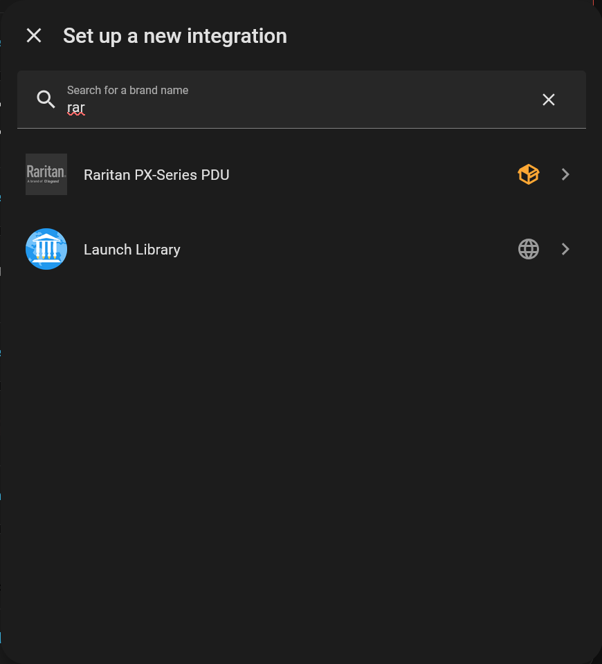
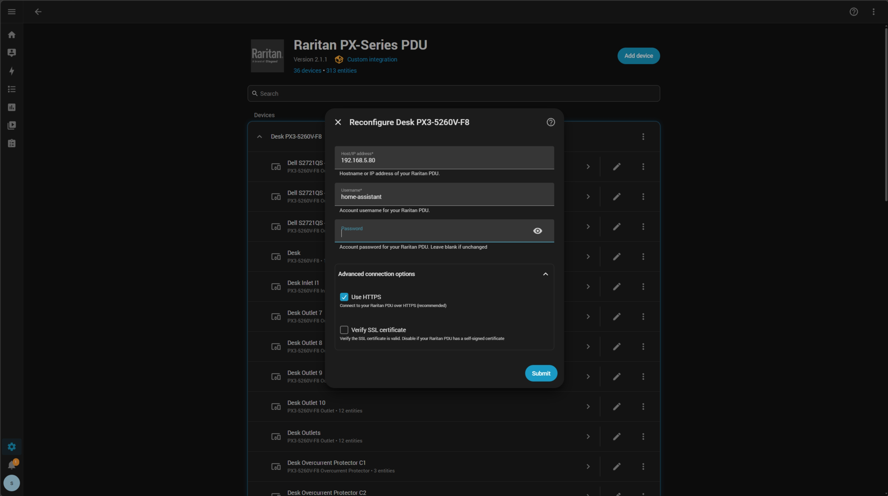
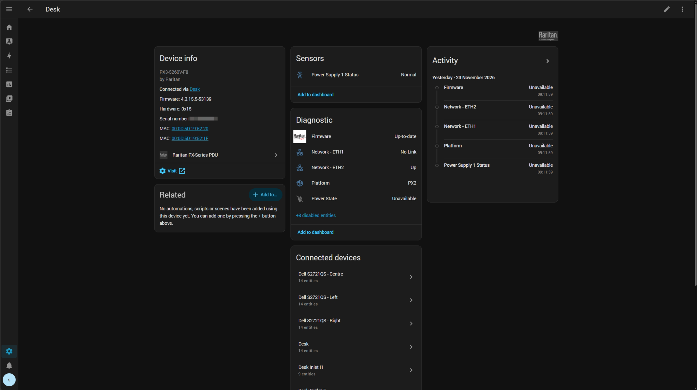
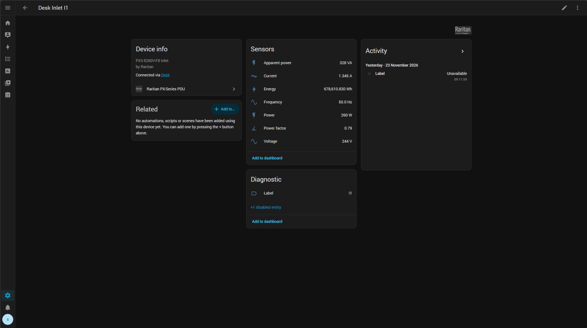
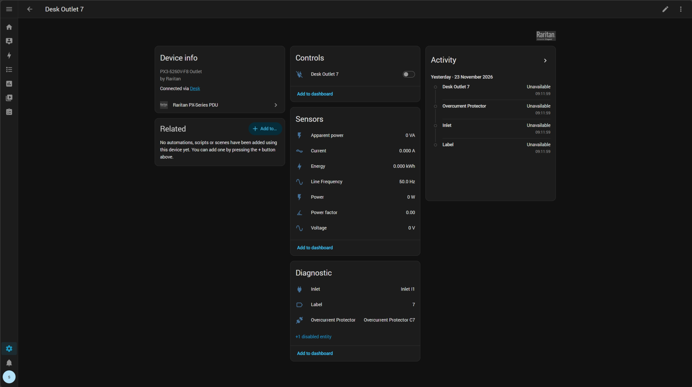
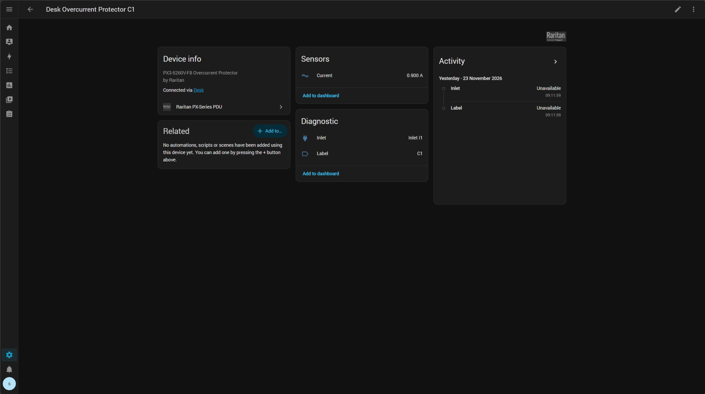

# Home Assistant Raritan PX-Series PDU Integration

A custom integration to expose and control your Raritan PX-Series Xerus™ PDUs within Home Assistant, using the built-in local [Xerus™ JSON-RPC API](https://help.raritan.com/json-rpc/4.3.15/index.html) - no Internet access required

This is an **unofficial** integration that is in **no way affiliated, endorsed or supported** by [Raritan](https://www.raritan.com) or [Legrand](https://www.legrand.com/en)

## Features

* Power & Energy sensors[^1]
  * Supported at PDU, inlet, outlet and overcurrent protector levels
* Outlet switching
* Network status
* Firmware updates[^6][^3]

[^1]: Current, Voltage, Line Frequency, Power, Energy, etc.
[^6]: Firmware updates are supported for Raritan PX2, PX3, PXO & PXC models.
[^3]: The list of available firmware updates is supplied from a [dedicated catalogue](https://github.com/exterrestris/ha-raritan-px-firmware) for this integration

> [!TIP]
> The specific features and sensors exposed to Home Assistant depend on the functionality supported by your PDU.
> * Outlet level switching requires a 2000 or 5000 Series PDU.
> * Outlet level metering requires a 4000 or 5000 Series PDU
>
> For the exact features supported by your PDU, refer to Raritan's [PDU Product Selector](https://www.raritan.com/product-selector) for your model

## Supported Devices

Any PX-Series (`PX2`/`PX3`/`PX4`/`PXO`/`PXC`) PDU running Xerus `4.3.11` or greater

> [!TIP]
> PX-Series PDU running Xerus `4.3.0` or greater are likely to work without problems
>
> However, updating your PDU's firmware to the latest available version is recommended

> [!NOTE]
> Whilst any PX-Series PDU running Xerus `4.3.0` or greater _should_ work, I can only test with the PDUs I own. A list of [known working devices](#known-working-devices) is provided below
>
> PX-Series PDUs running Xerus `4.0.10` or greater _may_ work, but I have not checked the API changelog for breaking changes.
>
> PDUs made by other brands that also run Xerus `4.3.0` or greater (such as [Server Technology](https://www.servertech.com/) PRO4X PDUs) _may_ also work but are untested
> PX-Series PDUs running Xerus `4.0.10` or greater _should_ work, but some features may not function correctly if the API had breaking changes

> [!WARNING]
> PX-Series PDUs running Xerus `3.6.xx` and earlier will **not** work

### Known Working Devices

- [Raritan PX3-5145R](https://www.raritan.com/product-selector/pdu-detail/px3-5145r)
- [Raritan PX3-5190R](https://www.raritan.com/product-selector/pdu-detail/px3-5190r) (@exterrestris)
- [Raritan PX3-5260R](https://www.raritan.com/product-selector/pdu-detail/px3-5260r)
- [Raritan PX3-5260V-F8](https://www.raritan.com/product-selector/pdu-detail/px3-5260v-f8) (@exterrestris)

### Non-Raritan PDUs

PDUs made by other brands that also run Xerus `4.3.0` or greater (such as [Server Technology](https://www.servertech.com/) PRO4X PDUs) _may_ work but are untested

## Installation

This integration is included in the default catalogue for [Home Assistant Marketplace](https://www.home-assistant.io/integrations/marketplace/)[^2]. Click the button below to open this repository in your Home Assistant instance, then click install

[^2]: Previously [HACS](https://github.com/hacs/integration) prior to Home Assistant 2026.11

> [!NOTE]
> If you have not previosly opened the Marketplace, you will be warned that Marketplace content is not supported by the Home Assistant project. Before you can install any Marketplace content, you will need to understand and accept that warning

> [!WARNING]
> [!WARNING]
> If you are not comfortable with installing integrations that are not supported by the Home Assistant project, then **do not** install this integration

## Setup

1. Go to [Settings > Devices & services](https://my.home-assistant.io/redirect/integrations/)

2. Click [Add integration](https://my.home-assistant.io/redirect/config_flow_start/?domain=raritan_px)

3. Search for and select "Raritan PX-Series PDU":

   

4. Enter the connection details for your Raritan PDU:

   

5. Your PDU will then be visible in Home Assistant!

> [!TIP]
> By default, the integration will try to connect to your Raritan PDU over HTTPS unless configured otherwise. If your PDU has a self-signed certificate be sure to disable certificate verification in the Advanced connection options.
>
> Installing a verifiable certificate on your PDU is recommended, and can be done via the PDUs Web UI

## FAQs

#### I can't see the energy usage for my PDU
Raritan PDUs report their energy usage by inlet, not for the PDU as a whole. For PDUs with one inlet, the total power usage for the PDU will be that of the inlet device

#### I can't see the energy usage by outlet
Outlet monitoring support is PDU specific. If your PDU supports outlet monitoring, then the relevant sensors will be exposed automatically

#### I can't turn my outlets on/off
Outlet switching support is PDU specific. If your PDU supports outlet switching, the switches for the outlets will be exposed automatically. In addition, the user Home Assistant uses to connect to your PDU needs to have the `Switch Outlet` privilege - this is granted to the `Admin` and `Operator` roles by default

#### I changed the name of my inlet/outlet/PDU via the PDU web UI, but the name hasn't updated in Home Assistant
Names are currently only updated when the integration first loads. Reloading the integration for the PDU will update the names in Home Assistant

#### How will I know if my PDU has a firmware update available?
Firmware updates for supported models[^6] are exposed via the standard Home Assistant update mechanism. If a new firmware update is available[^4] and can be installed on your PDU[^5], then the update will show up automatically

[^4]: Only firmware versions that apply to your PDU's model & product family, and that have a higher version than the firmware currently installed on your PDU are considered updates
[^5]: Depending on the existing firmware version on your PDU, it may not be possible to upgrade directly to certain firmware versions. In this case, the highest available firmware that supports upgrading from your current firmware will be shown as the available update. Once installed, any newer firmware versions that apply to your PDU will be automatically offered for installation.

#### I have a firmware update available, but I can't install it
To install firmware updates, the user that Home Assistant uses to connect to your PDU needs to have the `Firmware Update` privilege - this is only granted to users with the `Admin` role by default.

## Screenshots

### PDU

### Inlet

### Outlet

### Overcurrent Protector

